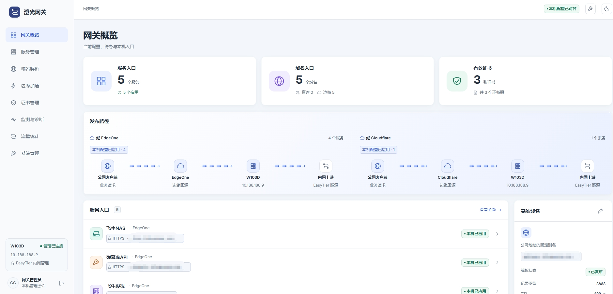
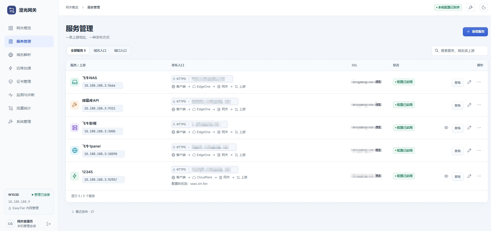
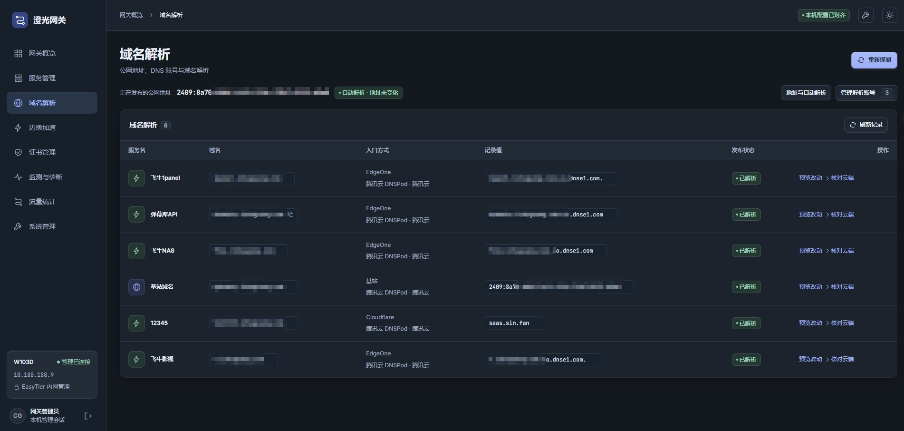
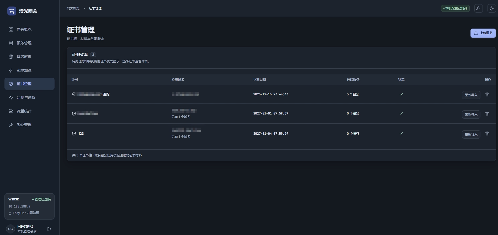
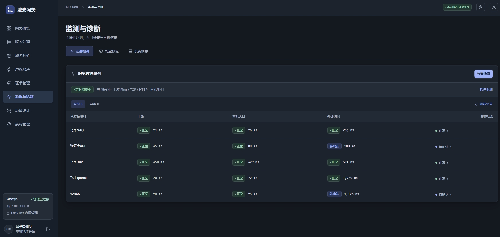
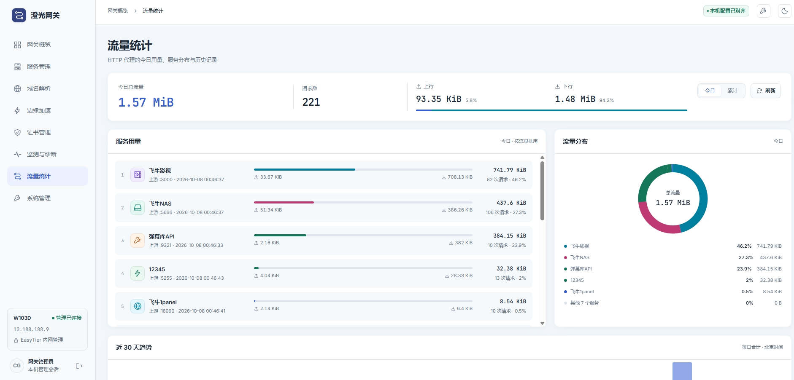

# 澄光网关 · Chengguang Gateway

**把 EasyTier 内网里的应用，变成可以通过域名或端口访问的服务。**

例如，你的 NAS、网站或其他 HTTP/HTTPS 应用在内网运行，可以用澄光网关统一管理它们的访问入口、域名和证书，也可以按需接入 Cloudflare 或腾讯云 EdgeOne。

**上手只需：下载 → 填好 3 项配置 → 运行 → 打开浏览器登录。** 不需要安装 Go、Node.js 或数据库，也不用自己编写 Nginx 配置。

当前版本：`0.8.0-dev`（开发预发布） · [MIT 许可证](LICENSE)

[快速开始](#快速开始) · [界面预览](#界面预览) · [常见问题](#常见问题) · [完整操作手册](docs/operator-guide.md)

## 能做什么

- **发布内网应用**：用独立 HTTP 端口访问，或绑定域名，通过 HTTPS 访问。
- **管理域名解析**：支持 DNSPod、Cloudflare DNS、阿里云 DNS，支持多个账号。
- **接入 CDN**：按需使用 Cloudflare for SaaS 或腾讯云 EdgeOne。
- **管理证书**：上传 HTTPS 证书，查看有效期；也可配合自己的 certd 更新证书。
- **查看运行情况**：检查连接是否正常，查看请求量、流量和通知。
- **先保存、再发布**：修改先保存为草稿，确认后再应用，不会保存一下就立即改动正在使用的服务。

这里的“端口发布”是 HTTP 网页应用转发，不是 SSH、数据库或任意 TCP/UDP 的端口映射。

## 快速开始

### 第一步：准备一台盒子或服务器

推荐使用 **Debian / Ubuntu 的 ARM64 Linux**，并确认：

- 能使用 root 或 `sudo`，并且能联网下载软件包。
- 已经接入 EasyTier 或其他 VPN，拿到了本机的 VPN IP。
- 管理用的电脑能够访问这个 VPN IP。

不知道机器是什么架构，可以运行：

```bash
uname -m
```

当前发行包适用于输出 `aarch64` 的机器，**不能直接在 `x86_64` 机器上运行**。

> 本项目会自动准备 Nginx 等运行组件，但不会替你安装 EasyTier、加入 VPN 或分配 IP。VPN 网段由你决定，没有固定网段要求。

### 第二步：下载并解压

打开 GitHub 项目页面的 **Releases**，选择一个版本，下载：

- `gateway-版本号-linux-arm64.tar.gz`：程序发行包。
- `SHA256SUMS`：用于确认下载文件是否完整。

**不要下载 “Source code”**，那是源代码，不是可以直接运行的程序。

把两个文件放到盒子的同一个目录。在该目录执行下面的命令；这里以 `0.8.0-dev` 为例，文件名请按实际下载的版本替换：

```bash
sha256sum -c SHA256SUMS &&
mkdir gateway &&
tar -xzf gateway-0.8.0-dev-linux-arm64.tar.gz -C gateway &&
cd gateway &&
sha256sum -c SHA256SUMS
```

校验通过后，目录里会有程序 `gateway-linux-arm64`、配置文件 `config.json` 和其他配套文件。**先校验，再填写配置；校验失败时不要继续启动。**

### 第三步：填写 config.json

用文本编辑器打开解压目录中的 `config.json`，只需填写三项：

```json
{
  "gatewayIp": "10.20.0.9",
  "port": 18080,
  "initialKey": "YOUR_INITIAL_KEY"
}
```

| 配置项 | 填什么 |
| --- | --- |
| `gatewayIp` | **这台盒子自己的 EasyTier/VPN IPv4**，不是 NAS 或其他上游应用的 IP。上面的 `10.20.0.9` 只是例子，请换成实际地址。 |
| `port` | 管理后台使用的端口。一般保留 `18080` 即可；如果已被占用，再换一个空闲端口。 |
| `initialKey` | 第一次登录后台使用的密码。请换成自己设置的 **12–128 个字符**，不能保留 `YOUR_INITIAL_KEY`。 |

配置文件和程序放在同一目录即可。**不要把填写了真实密码的配置文件上传到 GitHub。**

### 第四步：运行程序

保存配置后，在同一个目录执行：

```bash
chmod +x gateway-linux-arm64
chmod 600 config.json
sudo ./gateway-linux-arm64
```

如果你已经是 root 用户，最后一行直接运行 `./gateway-linux-arm64` 即可。

程序会依次完成：

1. 检查配置中的 IP 和端口能否使用。
2. 检查 Nginx、njs 等运行组件；缺少时通过 APT 自动安装，已有的不会重复安装。
3. 自动生成本项目的 Nginx 配置，启动代理和管理后台。

**首次运行可能需要等待软件下载和安装，请留意终端输出。** 如果提示权限、软件源或已有 Nginx 冲突，先按提示处理，不要强行关闭其他网站的服务。

### 第五步：打开浏览器登录

在能访问该 VPN 的电脑上，打开：

```text
http://你填写的 gatewayIp:你填写的 port/
```

例如上面的配置对应 [http://10.20.0.9:18080/](http://10.20.0.9:18080/)。

在登录页输入 `initialKey` 中填写的密码，就能进入后台。**不需要先配置域名、证书或云平台账号。**

登录后可以在 **系统管理 → 安全与会话** 修改密码。以后使用新密码登录；此时可以清空配置文件中的 `initialKey`。这个字段只用于首次设置密码，修改它不会重置已有密码。

> 这是前台运行方式：请保持进程运行。按 Ctrl+C 会退出，并停止本次启动的 Nginx。需要开机自启或长期后台运行时，参考 [系统服务安装与维护](docs/operator-guide.md#3-从-github-releases-安装)。管理后台应通过可信 VPN 访问，不要直接暴露明文管理端口到公网。

## 添加第一个应用

建议先用端口方式试通，再配置域名和 CDN：

1. 打开 **服务管理 → 新增服务**。
2. 填写应用名称和上游地址，例如 `http://10.20.0.20:8080`。这里才填写实际应用所在的 IP 和端口，先确认盒子能访问它。
3. 选择 **用端口发布**，不需要域名和证书。
4. 保存草稿，预览并发布，再按界面显示的地址访问。

需要 HTTPS 域名时，再导入证书、配置域名；需要 CDN 时，再添加 Cloudflare 或 EdgeOne 账号。详细步骤见 [发布应用教程](docs/operator-guide.md#4-从零创建第一个完整直连服务)。

上游可以和网关处于不同子网，只要路由可达。公网访问还需要网关有可入站的公网地址，并放行相应业务端口；程序不会自动修改防火墙，也不会为上游应用额外添加登录认证。

## 界面预览

截图用于展示界面。图中的 IP、域名和服务名称仅供参考，实际使用时填写自己的配置。

### 网关概览

一眼查看服务、域名、证书和访问路径。



### 服务管理

添加内网应用，管理域名或端口访问入口。



### 域名解析

查看 DNS 记录，确认域名是否已经发布。



### 证书管理

上传 HTTPS 证书，查看到期时间和关联服务。



### 监测与诊断

检查上游应用、本机入口和外部访问是否正常。



### 流量统计

查看请求量、上下行流量和各个服务的用量。



## 常见问题

| 问题 | 怎么处理 |
| --- | --- |
| 提示 IP 无法使用 | 确认 EasyTier 已经连接，`gatewayIp` 确实是这台盒子分配到的地址，不是另一台设备的 IP。 |
| 提示端口被占用 | 将 `port` 换成空闲端口，再重启。不要使用代理保留的 `80`、`443`、`18079`。 |
| 自动安装依赖失败 | 确认使用 root/sudo，网络和 APT 软件源可用。推荐 Debian/Ubuntu；其他发行版缺包时需要自行准备依赖。 |
| 提示已有 Nginx 冲突 | 先确认它属于哪个网站或服务。程序不会为了安装 Nginx/njs 而停止或升级正在运行的其他 Nginx。 |
| 浏览器打不开后台 | 确认程序仍在运行、电脑能访问该 VPN IP，并且地址中的 IP、端口与配置一致。 |
| 修改 `initialKey` 后密码没变 | 这是正常的：它不是密码重置开关。已有账号请使用当前密码登录，再到后台改密。 |

更多排查方法见 [操作手册](docs/operator-guide.md#12-常用运维命令与故障定位)。

## 数据和升级

- 启动配置保存在你自己的 `config.json`。
- 服务设置、证书等数据默认保存在 `/var/lib/gateway`，代理缓存位于 `/var/cache/gateway`。
- 升级前先备份配置和数据，**不要用新包里的空白 config.json 覆盖自己的配置**。
- 已通过旧脚本/systemd 安装的用户，继续按 [升级与回滚说明](docs/operator-guide.md#11-升级回滚和下线) 操作，不需要更换原有启动方式。

高级启动参数、SSH 转发和完整配置规则见 [配置说明](docs/operator-guide.md#34-配置文件直接启动)。

## 进一步了解

- [完整操作手册](docs/operator-guide.md)：部署、应用、证书、DNS、CDN、备份和排障。
- [下载、构建与发行](docs/github-release.md)：发行包、校验方法和 GitHub Actions。
- [贡献指南](docs/CONTRIBUTING.md)：开发环境、构建检查和代码贡献。
- [架构说明](docs/technical-optimization.md)：给需要了解内部实现的开发者。

<details>
<summary>开发者：从源码构建</summary>

普通用户直接下载发行包即可。自行构建需要 Node.js 22、npm、Git、`tar` 和符合 `go.mod` 的 Go 工具链：

```bash
node scripts/build.mjs
node scripts/package-release.mjs
```

程序和配套文件输出到 `dist/release`，压缩包输出到 `dist/packages`。运行时使用的配置模板来自 `config.example.json`，不会把开发机的真实登录密钥放进发行包。

</details>

## 许可证

项目采用 [MIT License](LICENSE)。第三方组件遵循各自许可证，见 [第三方声明](THIRD_PARTY_NOTICES.md)。
